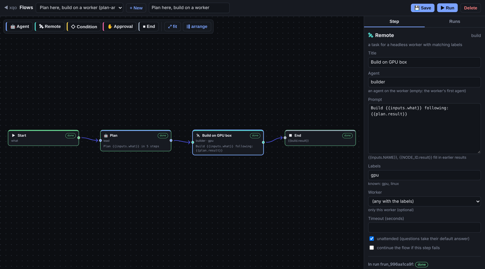

# xqo-flows

Visual workflows for [xqo](https://github.com/dudikkocak/xqo). You draw a flow of agent steps, conditions,
approvals and remote steps in a [FlowGram.AI](https://github.com/bytedance/flowgram.ai) editor (MIT). xqo runs
each step as an ordinary task, so it shows up in the dashboard, the task list and the 2D/3D office like any other.
Remote steps go to headless workers on other machines ([`xqo-flows-runner`](../xqo-flows-runner)).

```bash
pip install xqo-flows            # or: pip install "xqo[flows]"
```

```json
"flows": {}
```

Add that key to `agents.json` and restart `xqo serve`. Without the key the plugin stays inactive. The dashboard
header gets a **flows** link to the editor at `/plugins/flows/editor.html`. On first start two example flows are
written: `hello` and `draft-review-approve`.



## Drawing a flow

- **+ New** gives you a start node, one agent step and an end node. The palette adds more steps. To connect two
  steps, drag from a node's right edge to the next node's left edge. Click a step to edit it in the side panel.
  **Save** stores the flow as `artifacts/flows/<name>.json`, and backups include it.
- Step types:

| Step | What it does | Settings |
|---|---|---|
| **Start** | Where a run begins. Lists the flow's inputs. | `inputs: [{name, default}]` |
| **Agent** | Runs an xqo task for one of this HQ's agents (empty agent = the first agent). | `agent`, `prompt`, `unattended`, `continue_on_error` |
| **Remote** | Runs a task on a headless worker whose labels include all of the step's labels. | `labels`, `worker`, `agent`, `prompt`, `timeout`, `continue_on_error` |
| **Condition** | Takes the branch of the first rule that holds, otherwise `else`. | `conditions: [{key, left, op, right}]` with op `contains`, `not_contains`, `equals`, `not_equals`, `matches` (regex), `empty`, `not_empty`, `gt`, `lt` |
| **Approval** | Waits until you approve or reject. After the timeout it takes the default answer. | `question`, `timeout`, `default` |
| **End** | The run's result. | `output` (empty = the last step's result) |

- **Templates** in prompts, rules, questions and outputs: `{{inputs.topic}}`, `{{step_id}}` or `{{step_id.result}}`,
  `{{step_id.status}}`, `{{step_id.task_id}}`. A remote step also has `{{step_id.worker}}`.
- **Order:** when several lines leave one step, their targets run in parallel. A step with several incoming lines
  waits for every branch that is still alive. Branches a condition or approval did not take are skipped, so a join
  after a condition does not wait for them. Flows cannot loop.
- **Failures:** a failed step fails the run and cancels the steps still running. Steps with `continue_on_error`
  are the exception: the run carries on.

## Running a flow

| From | How |
|---|---|
| Editor | **▶ Run** asks for the inputs, then shows each step live: running, waiting, done, skipped or error. **Approve** and **Reject** buttons appear in the Runs tab. |
| CLI | `xqo flows run NAME -i topic="…"` follows the run, `--no-wait` returns at once. Also: `xqo flows list / show / import FILE / rm / runs / cancel RUN / resume RUN / approve RUN STEP [--reject] / triggers / workers / token` |
| Triggers | Schedules and webhooks (below) |
| API | `POST /api/flows/NAME/run` with `{"inputs": {...}}` returns the run. Read it with `GET /api/flows/runs/RUN_ID`, answer approvals with `POST /api/flows/runs/RUN_ID/approve` and `{"node": "...", "approve": true}`. |
| Agents | Agents listed in `agents_may_run` get a `run_flow` tool, which waits for the result. A step of a flow cannot start another flow. |

Each run is saved in `artifacts/flows/runs/<run_id>.json`. While a run waits for an approval, the dashboard shows
a toast that links to it.

**Resume.** If the server stops during a run, the run is marked `interrupted` at the next start. Press **↻ Resume**
on the run in the editor (or `xqo flows resume RUN`, or `POST /api/flows/runs/RUN_ID/resume`) to continue it:
steps that finished keep their results and the rest run again. Failed and cancelled runs can be resumed the same
way. A resume runs the flow as it was when the run started, even if you edited it since. A run that went to a
worker as a whole goes back to a worker with the same labels.

## Triggers

Triggers start runs without anyone pressing ▶ Run. Add them in the editor (click the canvas, then **+ schedule**
or **+ webhook** in the Flow panel), or in the flow's `triggers` list:

```json
"triggers": [
  {"id": "nightly", "type": "schedule", "cron": "0 2 * * 1-5", "tz": "Europe/Berlin", "inputs": {"topic": "the backlog"}},
  {"id": "hourly", "type": "schedule", "every": "1h"},
  {"id": "launch", "type": "schedule", "at": "2026-12-01T09:00"},
  {"id": "issue", "type": "webhook", "secret_env": "FLOW_ISSUE_SECRET", "inputs": {"topic": "{{body.issue.title}}"}}
]
```

| Key | Meaning |
|---|---|
| `cron` / `every` / `at` | Schedules: exactly one. `every` takes `30m`, `6h`, `1d`. Needs `pip install "xqo-flows[schedules]"`. |
| `tz` | The schedule's time zone (default: the HQ's) |
| `overlap` | `skip` (default): no new run while the trigger's last run is still going. `parallel`: start anyway. |
| `secret_env` | Webhooks: the environment variable that holds the secret. A plaintext `secret` is refused. |
| `trust` | Webhooks: `untrusted` (default) or `trusted`, see below |
| `max_per_minute` | Webhooks: calls allowed per minute (default 30), then `429` |
| `inputs` | The run's inputs. Webhook inputs can use `{{body}}`, `{{body.a.b}}` (JSON, lists by index) and `{{headers.x-github-event}}`. |
| `enabled` | `false` keeps the trigger but turns it off |

- **Schedules** keep their next and last run in `artifacts/flows/queue/triggers.json`. A run missed while the
  server was down by less than an hour runs once at start; older misses are skipped. `xqo flows triggers` lists
  every trigger with its next run, last run and the result.
- **Webhooks** are `POST /flows/v1/hooks/<flow>/<trigger id>` on the public listener (`listen`, the same one
  workers use), or `/api/flows/hooks/<flow>/<trigger id>` on the dashboard's own address. The caller sends
  `Authorization: Bearer <secret>`, or signs the body: `X-Hub-Signature-256: sha256=<HMAC-SHA256>` (what GitHub
  sends; `X-XQO-Signature` works the same). The answer is `202 {"run_id": ...}`; a wrong secret gets `401`.
- Values from a webhook request reach the prompts inside `<untrusted_webhook_data>` markers, so agents treat them
  as data, not instructions. Set `"trust": "trusted"` only for callers you control.

## Remote workers

A worker is a headless xqo on another machine: no dashboard and no office. It has its own `agents.json`, API keys,
sandbox and budgets. The worker connects out to the HQ and nothing listens on the worker, so it works behind NAT.
The HQ serves a small worker API on its own listener and lists each worker with its own token and its labels.
Because the HQ assigns the labels, a worker cannot take jobs meant for other workers.

```json
"flows": {
  "listen": "0.0.0.0:8200",
  "workers": {
    "lease_seconds": 60,
    "max_attempts": 2,
    "allow": {"gpu-box": {"token_env": "XQO_WORKER_GPU_BOX_TOKEN", "labels": ["gpu", "linux"]}}
  }
}
```

- A **Remote** step sends one task to a worker. The rest of the flow stays on the HQ.
- **Run the whole flow on a worker:** in the editor choose *Where: the whole flow on a worker*, or run
  `xqo flows run NAME --labels gpu` (also `--worker NAME` or `--remote`). The worker runs the flow with its own
  agents and sends each step's state back with its heartbeats, so the editor still shows the run live.
  **Approval steps** are still asked on the HQ: the question shows up in the editor, the dashboard toast and
  `xqo flows approve`, and the answer goes back to the worker with its next heartbeat (every second while an
  approval waits). Its timeout runs on the worker. A flow with Remote steps cannot run on a worker as a whole.
- **Cancel:** cancelling a run on the HQ cancels the worker's task at its next heartbeat. If a worker stops sending
  heartbeats for `lease_seconds`, its job goes back to the queue (at most `max_attempts` times, then it fails).
  Jobs still open when the HQ restarts are cancelled.
- `xqo flows workers` lists each worker with its online state and the job queue.

Worker setup: see [`xqo-flows-runner`](../xqo-flows-runner). There is a complete sample in
[`examples/setup/`](examples/setup): HQ and worker configs, a remote flow, Docker Compose files and an `.env`
template.

## Settings

| Key | Default | Meaning |
|---|---|---|
| `max_running` | 20 | Runs that can be going at once on this HQ |
| `approval_timeout` | 86400 | Seconds before an approval takes its default answer (0 = wait forever). A step's own `timeout` wins. |
| `agents_may_run` | `[]` | Agents that get `run_flow` (`"*"` = all agents) |
| `tool_timeout` | 3600 | How long `run_flow` waits for the run |
| `examples` | true | Write the example flows on the first start |
| `listen` | none | The public listener for the worker API and webhooks, `host:port`. `XQO_FLOWS_LISTEN` overrides it; `workers.listen` still works. |
| `workers` | none | Remote workers (above) |

## Security

- The dashboard and `/api/flows` have no login, the same as the rest of xqo, so keep them on `127.0.0.1`. Only the
  public listener (`listen`: the worker API and webhooks) is meant to be reachable from other machines. Workers
  need a per-worker bearer token and webhooks their own secret, both from environment variables; plaintext
  tokens and secrets in the config are refused. Put the listener behind TLS (a reverse proxy) when it crosses an
  untrusted network.
- Webhook values are marked as untrusted data in prompts unless the trigger says `"trust": "trusted"`, and each
  webhook is rate limited.
- Agent steps run with the agent's normal tools, grants and budgets. Steps are `unattended` by default, which
  means questions to you take their default answer, as in scheduled runs. Untick it to make a step wait for
  you.

## The editor

The editor source is in [`editor/`](editor), written in React and FlowGram.AI `@flowgram.ai/free-layout-editor`
1.0.16, which is pinned. It is built into `src/xqo_flows/static/editor.js`, so installing the package needs no
Node. To change the editor:

```bash
cd packages/xqo-flows/editor
npm ci && npm run build      # CI rebuilds it and fails if the committed bundle is out of date
```
